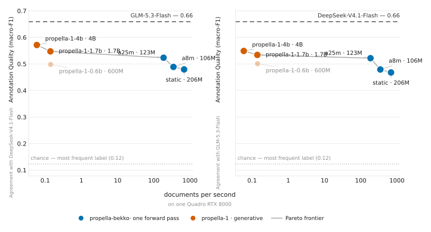

<p align="center">
  
</p>

# propella-bekko

Small, fast document annotators that predict the
[propella-1](https://huggingface.co/ellamind/propella-1-4b) label space — content quality,
information density, educational value, content type, business sector, safety, PII, regional and
country relevance — in **a single forward pass**, without generating text. The labels are
propella-1's own, except `country_relevance`, which keeps the 64 most frequent countries plus
`other` (see [decisions](docs/decisions.md)).

The goal is to make annotating large pretraining corpora (e.g. the
[Dynawords](https://huggingface.co/collections/danish-foundation-models/dynawords)) cheap enough to
run on everything, while staying [Pareto-optimal](#results) against the three propella-1 models
(0.6B / 1.7B / 4B).

Motivation: [swedish-dynaword#79](https://huggingface.co/datasets/danish-foundation-models/swedish-dynaword/discussions/79).

## Published

| model | backbone | throughput | card |
|---|---|---|---|
| `propella-bekko-static` | bekko-static-embedding-v1, no attention | 296 docs/s | [Hub](https://huggingface.co/danish-foundation-models/propella-bekko-static) |
| `propella-bekko-a8m` | bekko-embedding-v1-a8m | 248 docs/s | [Hub](https://huggingface.co/danish-foundation-models/propella-bekko-a8m) |
| `propella-bekko-a25m` | bekko-embedding-v1-a25m | 188 docs/s | [Hub](https://huggingface.co/danish-foundation-models/propella-bekko-a25m) |

The published repos are submodules of this one — [`models/`](models) holds the three model repos,
[`dataset/`](dataset) the data release — so a card is edited in place, reviewed in this repository's
diff and published by pushing the submodule (`make checkout` on a fresh clone).

The annotations they were trained on, with the two independent reference annotation sets, are in
[propella-bekko-data](https://huggingface.co/datasets/danish-foundation-models/propella-bekko-data)
(datasheet included).

## How it works

* **Teacher labels**: existing propella-1-4b annotations from the annotated Dynawords
  (`data/*/metadata.parquet`) and
  [openeurollm/propella-annotations](https://huggingface.co/datasets/openeurollm/propella-annotations)
  (FineWeb-2, FinePDFs), joined with their source texts. Nothing is re-annotated.
* **Students**: a backbone plus one classification head per property (softmax for single-select,
  sigmoid for multi-select). The three backbones are, smallest first,
  [`bekko-static-embedding-v1`](https://huggingface.co/hotchpotch/bekko-static-embedding-v1) (no
  Transformer layers), [`bekko-embedding-v1-a8m`](https://huggingface.co/hotchpotch/bekko-embedding-v1-a8m)
  and [`bekko-embedding-v1-a25m`](https://huggingface.co/hotchpotch/bekko-embedding-v1-a25m).
* Full-document length features (characters, words, whether the text was truncated) are passed to the
  heads, so length-dependent properties stay learnable under truncation.
* `one_sentence_description` (free text) is not predicted.

## Quickstart

```bash
make install                 # uv sync: Python 3.12, torch cu129
make data                    # held-out set, 1,000-doc test sample, both training pools
make models                  # train the three published students
```

Each model card carries a copy-paste inference snippet that needs only `transformers`, `torch` and
`safetensors` — no custom package, no `trust_remote_code`. The full pipeline, including the
independent reference annotations, the propella-1 baselines, the figures and the model cards, is in
[`docs/reproducing.md`](docs/reproducing.md).

## Results

Agreement with two annotators that are not the teacher — DeepSeek-V4.1-Flash and GLM-5.3-Flash — on
the same 300 held-out documents, macro-F1 across all properties. Throughput is documents per second
on one RTX A6000, in bf16 for every model; chance (always predicting the most frequent label) is
0.123.

<p align="center">
  
</p>

<!-- start results-table -->
| model | params | docs/s | vs DeepSeek-V4.1-Flash | vs GLM-5.3-Flash |
|---|---|---|---|---|
| **propella-bekko-a25m** | 123M | 188 | 0.519 | 0.510 |
| propella-bekko-a8m | 106M | 248 | 0.489 | 0.479 |
| propella-bekko-static | 206M | 296 | 0.479 | 0.468 |
| propella-1-0.6b | 600M | 2.73 | 0.501 | 0.500 |
| propella-1-1.7b | 1.7B | 2.11 | 0.548 | 0.535 |
| propella-1-4b | 4B | 1.00 | 0.571 | 0.544 |
| DeepSeek-V4.1-Flash | — | — | — | 0.659 |
| GLM-5.3-Flash | — | — | 0.659 | — |
<!-- end results-table -->

`a25m` is the point of the exercise: 0.05 short of the 4B teacher's agreement with an independent
annotator at roughly 190× its throughput, and `static` is the cheapest useful point — still four
times chance. The propella-1 models are much faster here than in the first release of these numbers,
because the baselines now generate free-form JSON instead of using a schema-constrained decoder that
was spending most of the runtime in the decoder.

Property by property, against both reference annotators on the same 300 documents (`a25m` in cyan,
propella-1-4b in pink; DeepSeek-V4.1-Flash left, GLM-5.3-Flash right):

<p align="center">
  
</p>

Most of the distance to the teacher sits in `content_length` (−0.26), `country_relevance` (−0.23) and
`commercial_bias` (−0.16), while six properties are already at or above propella-1-4b's own score
(`audience_level`, `content_quality`, `content_ratio`, `educational_value`, `information_density`,
`pii_presence`); against GLM-5.3-Flash the mean gap is half as large and seven are at or above.
Each model repo carries its own copy of that figure.

Against the stored propella-1-4b labels on the full 1,000 held-out documents, the same models score
0.820 (`a25m`), 0.779 (`a8m`) and 0.747 (`static`) on the paper's overall score.

What moved those numbers — and what did not — is measured in [`experiments/`](experiments/):
expected-value decoding for the ordinal properties (+0.013 QWK), a third epoch (+0.001), and no gain
from pool cleaning, checkpoint averaging, bigger backbones or label-name initialisation.

## Repository layout

```
src/propella_bekko/
  schema.py        propella-1 label space (17 predicted properties)
  data/            source registry + held-out / train set builders
  models/          backbones (static, transformer) + multi-head annotator
  encoding.py      tokenisation, head+tail truncation, batching
  train.py         training loop
  metrics.py       agreement metrics (accuracy, macro-F1, QWK, Jaccard, ...)
  inference.py     fast length-bucketed annotation + throughput benchmark
  cli.py           `propella-bekko` command line
configs/           one config per run: the published ones plus what was tried and rejected
experiments/       notes + results per experiment, indexed in experiments/README.md
docs/              model sheet, evaluation design, reproducing.md, assets
scripts/           data builds, reference annotation, scoring, figures, cards (scripts/README.md)
```

## Development

```bash
make lint    # ruff format + ruff check --fix + ty
make test    # pytest
make check   # what CI runs (no auto-fixing)
```

Work is tracked in [issues](../../issues), grouped by milestone; the issue currently being worked on
carries the `in progress` label.
