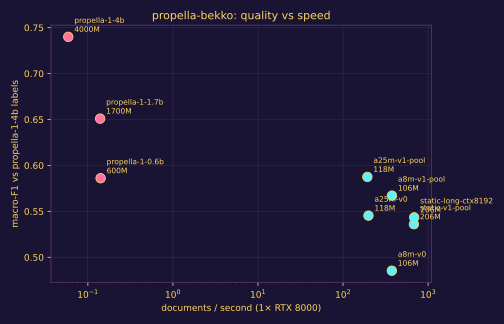

<p align="center">
  
</p>

# propella-bekko

Small, fast document annotators that predict the
[propella-1](https://huggingface.co/ellamind/propella-1-4b) label space
(content quality, educational value, content type, business sector, safety, PII,
regional relevance, ...) in **a single forward pass**, without generating text.

The goal is to make annotating large pretraining corpora (e.g. the
[Dynawords](https://huggingface.co/collections/danish-foundation-models/dynawords))
cheap enough to run on everything, while staying
[Pareto-optimal](#results) against the three propella-1 models (0.6B / 1.7B / 4B).

Motivation: [swedish-dynaword#79](https://huggingface.co/datasets/danish-foundation-models/swedish-dynaword/discussions/79).

## How it works

* **Teacher labels**: existing propella-1-4b annotations from the annotated
  Dynawords (`data/*/metadata.parquet`) and
  [openeurollm/propella-annotations](https://huggingface.co/datasets/openeurollm/propella-annotations)
  (FineWeb-2, FinePDFs), joined with their source texts.
* **Students**: a backbone + one classification head per property
  (softmax for single-select, sigmoid for multi-select). Backbones, smallest first:
  1. [`bekko-static-embedding-v1`](https://huggingface.co/hotchpotch/bekko-static-embedding-v1) (no Transformer layers)
  2. [`bekko-embedding-v1-a8m`](https://huggingface.co/hotchpotch/bekko-embedding-v1-a8m)
  3. [`bekko-embedding-v1-a25m`](https://huggingface.co/hotchpotch/bekko-embedding-v1-a25m)
* Full-document length features (characters, words, whether the text was truncated) are passed to the
  heads so length-dependent properties stay learnable under truncation.
* `one_sentence_description` (free text) is not predicted.

## Quickstart

```bash
make install                     # uv sync (Python 3.12, torch cu129)

# held-out evaluation set (languages x domains), then a training set that excludes it
uv run propella-bekko build-data --dynaword all --n-per-subset 100 \
    --propella fineweb-2:all finepdfs:all --n-per-lang 300 --output data/heldout.parquet
uv run propella-bekko build-data --dynaword all --n-per-subset 2000 \
    --propella fineweb-2:all finepdfs:all --n-per-lang 5000 \
    --exclude data/heldout.parquet --output data/train.parquet

uv run propella-bekko train --config configs/static-v0.json
uv run propella-bekko evaluate  --model runs/static-v0/model --data data/heldout.parquet
uv run propella-bekko benchmark --model runs/static-v0/model --data data/heldout.parquet
uv run propella-bekko annotate  --model runs/static-v0/model --input docs.parquet --output annotations.parquet
```

## Results

The propella-1 **overall score** (11/17 × mean quadratic-weighted kappa over the 11 ordinal
properties + 1/17 × PII F1 + 5/17 × mean intersection-over-union over the 5 multi-select
properties, §5.2 of [the paper](https://arxiv.org/abs/2602.12414)) on **1,000 held-out
documents**, against two references. Throughput is documents/second on one Quadro RTX 8000.

<p align="center">
  
</p>

| model | params | docs/s | vs stored propella-1-4b labels | vs DeepSeek-V4.1-Flash |
|---|---|---|---|---|
| propella-1-4b (reference, re-run) | 4B | 0.22 | 0.875 | 0.737 |
| propella-1-1.7b | 1.7B | 0.50 | 0.808 | 0.703 |
| propella-1-0.6b | 0.6B | 0.50 | 0.763 | 0.679 |
| **a25m-xl-3ep** | 118M | **186** | **0.820** | **0.724** |
| a8m-v1-pool | 106M | 376 | 0.779 | 0.694 |
| static-v1-pool | 206M | 686 | 0.747 | 0.678 |

* **`a25m-xl-3ep`** (25M active parameters, distilled from 845k documents) **beats
  propella-1-1.7b on both references** — 0.820 vs 0.808 against the stored propella labels and
  0.724 vs 0.703 against the independent DeepSeek annotations — at ~370× the throughput. It
  lands 0.013 short of propella-4b on the independent reference at 845× the throughput.
* Ordinal properties are decoded to the **expected level** of the predicted distribution
  rather than by argmax, which is worth +0.013 mean QWK for free
  ([`experiments/010`](experiments/010-gliclass-and-decision-models.md)).
* The **static model** (no Transformer layers) is the cheapest useful point: 686 docs/s at
  0.747, and `a8m` sits in between at 376 docs/s.

Per-run details in [`experiments/`](experiments/). Tracked in the
[tracking issue](../../issues?q=label%3Atracking).

## Repository layout

```
src/propella_bekko/
  schema.py        propella-1 label space (17 predicted properties)
  data/            source registry + held-out / train set builders
  models/          backbones (static, transformer) + multi-head annotator
  encoding.py      tokenisation, head+tail truncation, batching
  train.py         training loop
  metrics.py       agreement metrics (accuracy, macro-F1, QWK, Jaccard, ...)
  inference.py     fast length-bucketed annotation + throughput benchmark
  cli.py           `propella-bekko` command line
configs/           one config per experiment
experiments/       notes + results per experiment
docs/              decisions, evaluation design, assets
scripts/           misc (banner rendering)
```

## Development

```bash
make lint    # ruff format + ruff check --fix + ty
make test    # pytest
make check   # what CI runs (no auto-fixing)
```

Work is tracked in [issues](../../issues), grouped by milestone; the issue currently
being worked on carries the `in progress` label.
