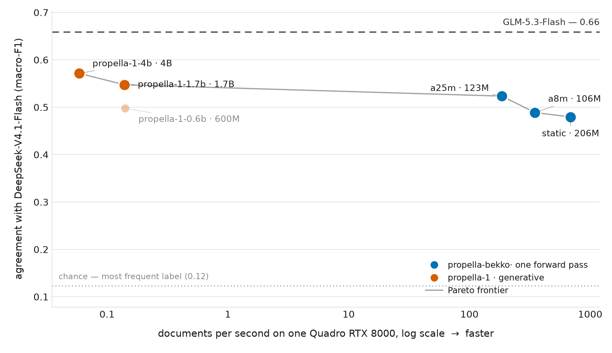

# propella-bekko: annotating a corpus in one forward pass

*29 October 2026*

Every Dynaword corpus needs the same thing before it can be used for training: a description of
each document — how complete it is, how dense, whether it is educational, what sector it belongs
to, whether it contains personal data. [propella-1-4b](https://huggingface.co/ellamind/propella-1-4b)
predicts that label space well, but it does it by generating, at about **0.06 documents per second
on a Quadro RTX 8000**. Annotating a hundred million documents with it is not a weekend job.

`propella-bekko` is a family of small annotators that predict the same 17 properties in **one
forward pass**, without generating any text. The largest is 123M parameters and runs at **186
documents per second** on the same GPU; the smallest is a static embedding model at **686**.

This is the release post for the first three models, the numbers behind them, and what did and did
not work on the way.

## The three models

| model | backbone | params | docs/s | GPU-hours per 1M docs |
|---|---|---|---|---|
| `propella-bekko-static` | bekko-static-embedding-v1 (no attention) | 206M | 686 | 0.40 |
| `propella-bekko-a8m` | bekko-embedding-v1-a8m | 106M | 348 | 0.80 |
| `propella-bekko-a25m` | bekko-embedding-v1-a25m | 123M | 186 | 1.49 |

All three share one recipe: a document encoder, one head per property (softmax for the 11 ordinal
properties, sigmoid for the 5 multi-label ones, a token-level F1 head for PII), trained on the same
845k documents annotated by propella-1-4b. Nothing else differs, so the three points describe what
the backbone buys you.

## How good are they, against something other than their teacher?

The honest question about a distilled model is not whether it agrees with its teacher — it will,
that is what it was trained to do — but whether it tracks an *independent* annotator. We ran two
frontier LLMs over the same 300 held-out documents and scored every model against each of them,
separately, with macro-F1 over all 17 properties.

**Against DeepSeek-V4.1-Flash annotations**

| model | docs/s | agreement |
|---|---|---|
| GLM-5.3-Flash | 0.41 | 0.659 |
| propella-1-4b | 0.06 | 0.571 |
| propella-1-1.7b | 0.14 | 0.547 |
| **propella-bekko-a25m** | **186** | **0.523** |
| propella-1-0.6b | 0.14 | 0.498 |
| propella-bekko-a8m | 348 | 0.489 |
| propella-bekko-static | 686 | 0.479 |
| chance | — | 0.123 |

**Against GLM-5.3-Flash annotations**

| model | docs/s | agreement |
|---|---|---|
| DeepSeek-V4.1-Flash | 0.34 | 0.659 |
| propella-1-4b | 0.06 | 0.549 |
| propella-1-1.7b | 0.14 | 0.534 |
| **propella-bekko-a25m** | **186** | **0.522** |
| propella-1-0.6b | 0.14 | 0.501 |
| propella-bekko-a8m | 348 | 0.479 |
| propella-bekko-static | 686 | 0.468 |
| chance | — | 0.123 |



Three things fall out of this:

1. **a25m lands in the same place under either reference** (0.523 / 0.522), and it is above
   propella-1-0.6b on both — a 123M one-pass model beating a 600M generative one on an independent
   annotator's judgement, at roughly 1,300× the throughput.
2. **The two LLMs agree with each other at 0.659**, which is the practical ceiling for this
   comparison: the students are distilled from propella labels, so nothing they learn can push them
   far past the level at which propella and a frontier LLM disagree.
3. **Chance is 0.123.** Even the static model is four times chance, which is worth keeping in the
   picture — most of the "quality" gap between the student models is the last few points, not the
   first thirty.

## What worked, and what did not

Several ideas were tried and dropped before this release; `experiments/` documents each one.

**Expected-value decoding (kept).** The ordinal properties are decoded to the expected level
(`round(Σ pᵢ · rankᵢ)`) instead of `argmax`. No retraining, +0.013 QWK, paper score 0.811 → 0.819.
The head was already emitting a distribution; `argmax` was throwing it away.

**Label-name initialisation (rejected).** Seeding each classifier row with the pooled embedding of
its label's own name — the cheap half of GLiClass's idea — helped rare classes in principle and hurt
in practice: a25m-v3 scored 0.834 single-answer accuracy against 0.855 for the same recipe without
it. Documented and dropped.

**Layer-averaging / SWA (neutral).** 0.854 against 0.855. Not worth the extra state.

**Pool cleaning and domain/language caps (slightly worse).** Each one cost 0.004–0.010 accuracy. The
data curve had not flattened, so removing data removed signal.

**Longer context (saturates at 8k).** Swept the static model over 4k/8k/16k/32k: 0.814 / 0.815 /
0.815 / 0.814, throughput 723 → 621 docs/s. The static backbone pools token vectors, so word order —
and therefore the value of long context — is gone before it arrives. 8k with a 512-token tail is the
default. Whether the attention backbones benefit from more than their current 1,024 tokens is
**still open**; it costs tokens per document roughly linearly, and nobody has run it.

## Using them

```python
from huggingface_hub import snapshot_download
from propella_bekko.models import PropellaBekko
from propella_bekko.inference import Annotator

path = snapshot_download("danish-foundation-models/propella-bekko-a25m")
model, tokenizer, cfg = PropellaBekko.load(path)
annotator = Annotator(model, tokenizer, cfg["max_length"], cfg["tail_tokens"])

print(annotator.annotate([{"id": "doc1", "text": "..."}]))
```

## What they are not

They are a distillation of **one teacher's judgement**, and they reproduce its systematic errors as
faithfully as its correct calls. Agreement measured against propella labels flatters them by
construction; the LLM-referenced numbers above are the fairer test, and they are lower. They also
inherit the taxonomy — a document that does not fit it gets the nearest available label — and they
truncate at 1,024 tokens (8,192 for the static model) with length features passed to the heads so
that length-dependent properties stay learnable.

If you need the best annotation available and can afford it, use the teacher. If you need to
annotate everything, use these.

## Next

- Whether the attention backbones earn their keep at 4k–8k tokens per document.
- Calibration: the per-property distributions are exported, but ECE/Brier are not yet reported.
- More languages in the distillation pool, and a Dynaword annotation pass using the released models.

Models: [`propella-bekko-static`](https://huggingface.co/danish-foundation-models/propella-bekko-static),
[`propella-bekko-a8m`](https://huggingface.co/danish-foundation-models/propella-bekko-a8m),
[`propella-bekko-a25m`](https://huggingface.co/danish-foundation-models/propella-bekko-a25m) ·
Code and experiments: [danish-foundation-models/propella-bekko](https://github.com/danish-foundation-models/propella-bekko) ·
Teacher: [propella-1](https://arxiv.org/abs/2602.12414)
